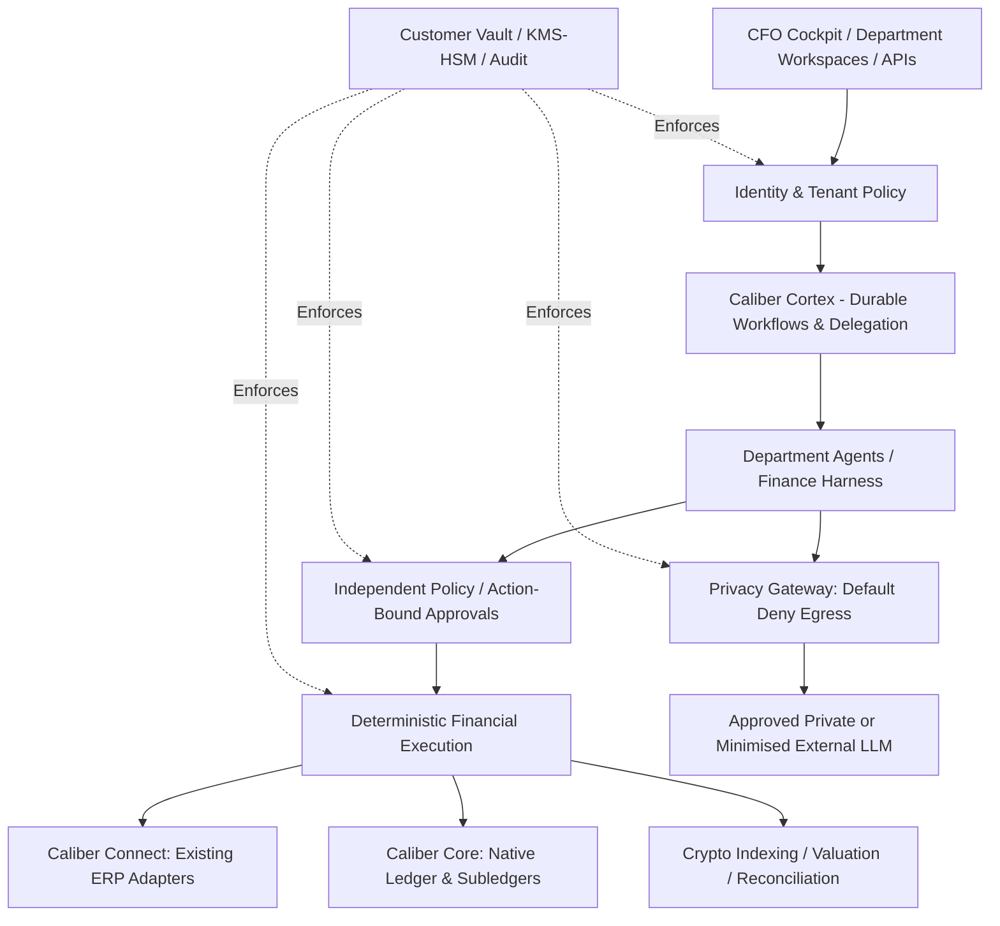

# Caliber Architecture v1.1 — Approved Competitive Direction
Date: 2026-10-17
Status: Design approved; implementation not yet validated
Branch: architecture/v1-sovereign-finance-os

## Decisions
1. Caliber Sovereign: customer-controlled vault, key grants, private-by-default model routing, tenant isolation and independently enforceable permissions.
2. Caliber Connect: agentic operating layer for existing ERPs (NetSuite, Xero, SAP and others). External ERP remains authoritative for postings unless expressly configured otherwise.
3. Caliber Core: optional native double-entry ledger, AP/AR subledgers, consolidation, financial reporting, revenue recognition and period close.
4. Shared vertical departments: CFO, Head of Finance/Controller, AP, AR, Credit Control, Treasury, Cashier, FP&A, Tax, Payroll, Crypto and Audit.
5. AP first complete vertical; AR and credit control next; crypto ingestion and reconciliation in parallel.
6. Benchmark Rillet on continuous accounting, source-linked financial intelligence, multi-entity consolidation, revenue recognition and agentic workflows. Do not claim Caliber has shipped these.

## Logical boundaries

## Agent contract
Every versioned agent defines: tenant scope, role, supervisor, permitted tools, accessible data classes, country pack versions, proposed actions, approval thresholds, escalation policy, evidence requirements, idempotency key and evaluation suite. No agent self-approval. Human and bank authority remain external to LLM decisions.

## Financial integrity
- Fixed precision money; balanced journals; posted records corrected through reversals.
- Source-linked entries, traceable reports, immutable evidence references and period locks.
- Reconcile ERP sync using durable outbox, retries and idempotent connector writes.
- Connected ERP and native ledger modes must never both silently claim system-of-record authority.
- Revenue recognition: versioned contract obligations, amendments, schedules and audit trails; accounting policy reviewed by qualified professionals.
- Consolidation: entity hierarchy, intercompany eliminations, FX translation and group close controls.
- Continuous accounting: transaction-time checks, daily reconciliation and exception queues; period-close approval remains explicit.

## Sovereign threat model — minimum controls
- Per-tenant data and vector-store isolation; encryption in transit and at rest; customer-managed keys where selected.
- Tenant-specific data-classification and model allowlists; default-deny external LLM egress; fail closed if redaction/classification unavailable.
- Restricted operator access; time-limited key grants; verified key rotation and revocation.
- Action-bound approval signed over exact tenant, actor, amount, destination, payload hash, expiry and nonce; replay resistance.
- No customer data in telemetry, prompts, development fixtures or Git history.
- Customer-held encryption keys alone do not guarantee zero plaintext access in managed SaaS.

## Crypto design
Raw immutable chain evidence -> finality-aware adapters -> canonical event schema -> protocol decoding -> entity wallet ownership -> pricing/cost basis -> reconciliation -> crypto subledger -> GL and dashboards. Chain reorgs, duplicates, bridges, staking and DeFi are explicit exception classes. Start EVM, Solana and Bitcoin adapters; scale chain coverage via provider adapters and evaluation tests.

## Implementation work packages
| ID | Priority | Package | Acceptance gate |
|---|---|---|---|
| SEC-00 | P0 | Audit public repository finance snapshots and secrets | Classify synthetic vs sensitive, history reviewed, remediation documented |
| SEC-01 | P0 | Sovereign vault and tenant identity ADR | Key custody, plaintext boundary, revocation and residency documented |
| SEC-02 | P0 | Harden existing gateway | Default private; invalid tiers rejected; redaction failure blocks egress; negative tests |
| ARC-01 | P0 | Agent contracts and Cortex/Harness integration ADR | Versioned schemas; per-tool policy; traceable workflow |
| FIN-01 | P0 | Ledger and canonical financial schema | Balanced immutable journals; FX; period locks; idempotency tests |
| AP-01 | P0 | Invoice-to-settlement vertical | Intake, OCR, PO match, approval, posting, payment proposal, settlement reconciliation |
| CON-01 | P1 | ERP adapters | At least one end-to-end sandbox ERP integration with reconciliation |
| AR-01 | P1 | Billing, cash application and credit control | Aged debt, approved communications, disputes, receipts and write-off controls |
| FIN-02 | P1 | Continuous close and source-linked reporting | Reconciled balances and report-to-document drilldown |
| FIN-03 | P1 | Revenue recognition and group consolidation | Contract schedules, intercompany elimination, FX tests |
| CRY-01 | P1 | Chain event ingestion and canonical schema | Replay/reorg/finality tests and chain source provenance |
| CRY-02 | P1 | Crypto pricing, subledger and reconciliation | Wallet/CEX/custody reconciliation and GL postings |
| UX-01 | P1 | CFO and department workspaces | Action queues, approvals, exceptions and traceable KPIs |
| QA-01 | P0 | Finance adversarial evaluation harness | Tenant leakage, payment diversion, prompt injection and approval bypass tests |
| OPS-01 | P1 | Sovereign/managed deployment blueprints | Network boundary, restore test, audit and operational runbooks |

## Rollout gates
No live financial data until SEC-00 complete. No external model routing until SEC-02 and security evaluations pass. No payments without independently verified bank approval controls. No production launch without customer isolation tests, reconciliation evidence, backup/restore, incident procedures and reviewed legal/privacy claims.

## Current implementation status
This document is a target design, not a claim of working integrations, certified security or test completion. Preserve existing gateway and website; do not merge to main without separate review.
